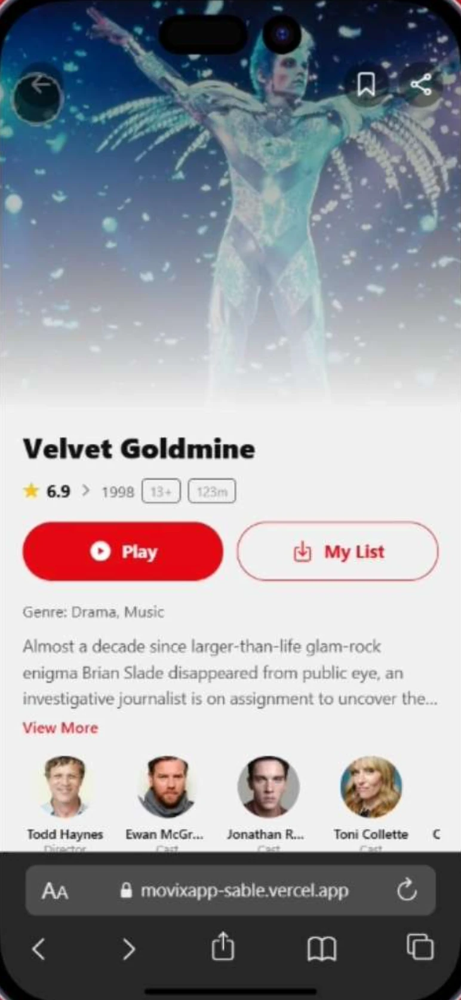
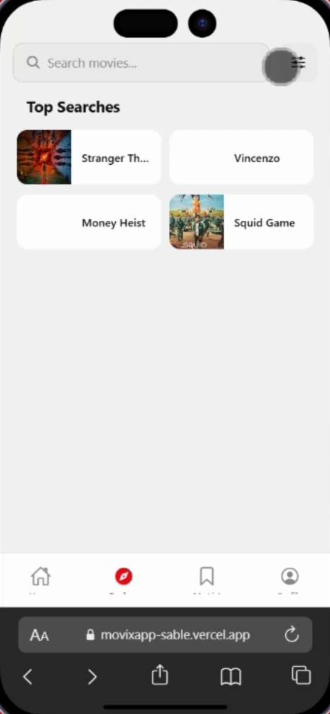
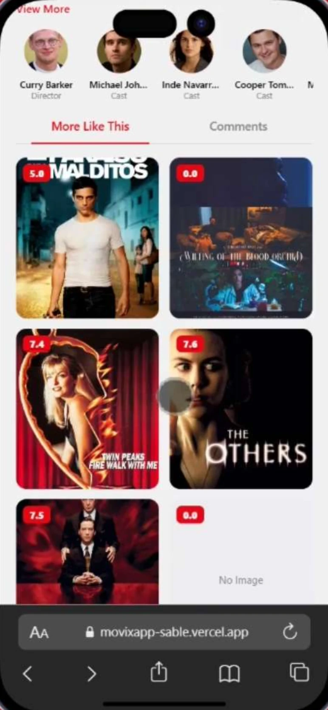

# Movix

A movie discovery app built with **React Native** and **Expo**. Browse trending and top-rated films, search titles, open details with cast and similar movies, and keep a personal watchlist. One codebase runs on Android, iOS and the web.

**Live web demo:** https://movixapp-sable.vercel.app

<p>
  
  
  
</p>

Built as my project for the A.I Basic React Native course at Algorithm Institute (certificate ID ALG-000045-B52E).

## Features

- **Home:** Top 10 Movies This Week, New Releases and Trending Now rows
- **Explore:** movie search that waits 500 ms after you stop typing before calling the API, plus top searches
- **Movie detail:** backdrop, rating, year, runtime, genres, overview, director and cast. A More Like This grid shows similar titles. Details and similar movies load at the same time.
- **My List:** save movies to a watchlist. The list is saved on the device, so it's still there after you close the app.
- **Profile:** view and edit your profile, and switch between light and dark themes

## Tech stack

| Area | Choice |
| --- | --- |
| Framework | React Native 0.81 (New Architecture) with Expo SDK 54 |
| Language | TypeScript |
| Navigation | React Navigation: bottom tabs inside a native stack, mounted from the Expo Router entry |
| State | React Context: watchlist, profile, theme |
| Persistence | AsyncStorage |
| Data | [TMDB API](https://developer.themoviedb.org/) |
| UI | expo-image, expo-linear-gradient, react-native-reanimated, Ionicons |
| Web | react-native-web, static export deployed on Vercel |
| Native builds | EAS Build (development, preview and production profiles) |

## Project structure

```
app/
  index.tsx              # Navigation: tabs (Home, Explore, My List, Profile) + Detail stack screen
  _layout.tsx            # Root layout and context providers
  context/               # WatchlistContext, ProfileContext, ThemeContext
  screens/               # MovieHome, Explore, Detail, MyList, Profile, EditProfile
components/              # Shared UI (MovieCard, themed text and view)
constants/
  tmdb.ts                # API endpoints, types, image URL helpers
  theme.ts               # Light and dark colour tokens
hooks/                   # Colour scheme and theme hooks
docs/screenshots/        # Images used in this README
eas.json                 # EAS Build profiles
vercel.json              # Web build and cache headers for Vercel
```

## How it works

- **Data:** every TMDB call is defined in `constants/tmdb.ts`. The app uses trending this week, now playing, popular, top rated, search, movie details (with credits) and similar movies.
- **Watchlist:** `WatchlistContext` loads the saved list from AsyncStorage when the app starts, and saves every change back.
- **Theme:** `ThemeContext` provides the light and dark palettes and a toggle (on the Profile screen) that every screen reads from.

## Getting started

**Requirements:** Node.js 18 or newer, npm, and a free [TMDB API key](https://www.themoviedb.org/settings/api).

```bash
git clone https://github.com/Daveohi/movix-app.git
cd movix-app
npm install
cp .env.example .env   # then add your EXPO_PUBLIC_TMDB_API_KEY
npx expo start
```

From the Expo CLI, press:

- `a` to open on an Android emulator or device
- `i` to open on the iOS simulator
- `w` to open in a web browser

You can also scan the QR code with Expo Go on your phone.

### Scripts

| Command | What it does |
| --- | --- |
| `npm start` | Start the Expo dev server |
| `npm run android` | Start and open on Android |
| `npm run ios` | Start and open on iOS |
| `npm run web` | Start and open in the browser |
| `npm run build:web` | Export the static web build to `dist/` |
| `npm run lint` | Lint with the Expo ESLint config |

## Environment variables

| Variable | Required | Default |
| --- | --- | --- |
| `EXPO_PUBLIC_TMDB_API_KEY` | Yes | none |
| `EXPO_PUBLIC_TMDB_BASE_URL` | No | `https://api.themoviedb.org/3` |
| `EXPO_PUBLIC_TMDB_IMAGE_BASE` | No | `https://image.tmdb.org/t/p/w500` |
| `EXPO_PUBLIC_TMDB_IMAGE_ORIGINAL` | No | `https://image.tmdb.org/t/p/original` |

> **Note:** Expo builds any `EXPO_PUBLIC_` variable into the app itself, so your TMDB key can be seen in the built app. Use a key that's only for reading public movie data, and keep `.env` out of git (it's already in `.gitignore`).

## Deployment

- **Web:** Vercel runs `npx expo export --platform web` and serves `dist/` (see `vercel.json`). Set `EXPO_PUBLIC_TMDB_API_KEY` in the Vercel project's environment variables.
- **Android and iOS:** build with EAS, for example `eas build --profile preview --platform android`.

## Credits

Movie data and images are provided by [TMDB](https://www.themoviedb.org/). This product uses the TMDB API but is not endorsed or certified by TMDB.

## Author

**David Ohimai**, mobile developer
- GitHub: [github.com/Daveohi](https://github.com/Daveohi)
- LinkedIn: [linkedin.com/in/david-ohimai](https://www.linkedin.com/in/david-ohimai)
- Email: daveohimai@gmail.com
